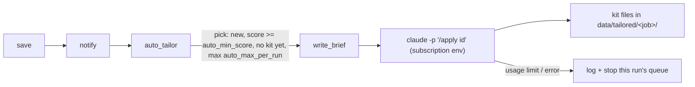

# Auto-tailor: unattended tailoring on the subscription

`handoff.py` + `/apply` already do the writing for one job, on the subscription, with a person watching (a new console window). This skill is the same thing **without a window**: after a run, the strongest new matches get their kit (`cv_tailored.md/.docx`, `cover_letter.md`, `interview_prep.md`, `changes.md`) ready before the owner opens the dashboard.

**Status: designed, not built.** Build order and acceptance check at the bottom.

## Flow


- One function, `handoff.run_headless(job_id, user=None, db_file=None, timeout=900) -> HeadlessResult`, next to `launch_claude`. The pipeline node and a CLI flag (`python -m jobhunter.handoff <id> --headless`) both call it.
- Pipeline node `auto_tailor_node` after `notify` (no-op when `auto_min_score` is null, on `--dry-run`, or when `claude_path()` is None). It runs jobs **one after another**, never in parallel (shared usage window, shared files).
- Like every collector: **never raises**. Catch everything, log it, add `auto_tailor` counts to the run stats (`tailored`, `tailor_failed`, `tailor_skipped_limit`).

## The command
```python
cmd = [claude_path(), "-p", f"/apply {job_id}",
       "--permission-mode", "acceptEdits",          # writes the .md files in data/tailored/<job>/
       "--permission-prompts", "none",              # nobody to answer: deny + don't retry (CLI >= 2.1.259)
       "--allowedTools", f"Bash({docx_rule} *)",    # the only shell command /apply needs
       "--output-format", "json"]
subprocess.run(cmd, cwd=ROOT, env=subscription_env(), capture_output=True,
               text=True, encoding="utf-8", timeout=timeout)
```
Pass `--user <id>` inside the prompt for non-owner users (`/apply <id> --user dana`).

### Rules that keep it on the subscription — do not "simplify" these away
1. **`env=subscription_env()` is mandatory.** In `-p` mode Claude Code uses `ANTHROPIC_API_KEY` *whenever it is present*, with no approval prompt, and `ANTHROPIC_AUTH_TOKEN` ranks even higher. The pipeline process has `.env` loaded, so without this every auto-tailor run bills the API.
2. **Never pass `--bare`.** Bare mode skips the subscription login (it reads only `ANTHROPIC_API_KEY` / `apiKeyHelper`) *and* skips skill discovery, so `/apply` would not exist.
3. Credentials come from `/login` (stored in `%USERPROFILE%\.claude\.credentials.json`) or from `CLAUDE_CODE_OAUTH_TOKEN` (a 1-year subscription token from `claude setup-token`). `subscription_env()` must **not** remove `CLAUDE_CODE_OAUTH_TOKEN`.

Details and sources: `references/claude-cli-headless.md`.

## Permissions
Nobody can approve anything, so the run gets exactly what `/apply` needs and nothing else:
- `acceptEdits` → Write/Edit of the kit files (inside the project folder).
- `--allowedTools "Bash(<python> -m jobhunter.handoff *)"` → the `--docx` conversion the brief asks for. Build `<python>` from `sys.executable`, the same string `docx_command()` puts in the brief, or the rule will not match. **Gotcha to verify on Windows:** backslashes/spaces in the path inside the rule. Test once by hand; if the rule does not match, the `.md` files are still written — convert them afterwards in Python with `markdown_to_docx()` instead of loosening permissions.
- Everything else is denied (`--permission-prompts none` also tells Claude not to retry and removes AskUserQuestion). `/apply` must therefore **not ask questions** in this mode: gaps go to `changes.md` (see the `apply` skill, "Unattended").

## Choosing jobs
- Only jobs saved as **new** in this run (not `rescored_ids`), `score >= tailoring.auto_min_score`, status still empty/new, and **no kit yet** (`kit_files(job_folder(job))` empty → re-runs never redo work).
- Highest score first, at most `tailoring.auto_max_per_run`.
- Owner only by default. Other users on the PC would spend the **owner's** Claude plan (one login per Windows user), so they need an explicit `tailoring.auto_min_score` in their own `users/<id>/config.yaml` overlay; `auto_from_cv` users never get it automatically.

## Usage limits and failures
- Every run counts against the plan's usage window, shared with the owner's own Claude use. Keep `auto_max_per_run` at 2–3 and schedule the search at night.
- Exit code 0 = success. Non-zero = failure; the JSON on stdout (`result`) says why (a missing login also appears there, not on stderr).
- If the result mentions a usage/session limit or 429: **stop the queue for this run** (`tailor_skipped_limit`), the next run picks the jobs up again (no kit yet).
- `subprocess.TimeoutExpired` → log, count as failed, continue with the next job.
- Write `auto_tailor.json` into the job folder: `{exit_code, session_id, result (first 500 chars), total_cost_usd, duration_s, at}`. `total_cost_usd` is a client-side estimate; on the subscription nothing is billed per call — show it only as "how heavy was this".
- Never change the job's `status`; the dashboard shows "קו"ח מוכן" when `kit_files()` is non-empty. The status stays the owner's field.

## Scheduling (Windows)
- Task Scheduler task runs `python run_agent.py` **as the owner's Windows user** ("Run whether user is logged on or not"), so `%USERPROFILE%\.claude` and the login are found. A SYSTEM task has no login.
- `/login` sessions expire; Claude Code warns 3 days ahead. For a machine nobody opens for weeks, prefer `CLAUDE_CODE_OAUTH_TOKEN` (set as a user env var, never in `.env`/git).
- Holds the run lock (`runlock.py`) for its whole duration, so the dashboard's "run now" cannot start a second run mid-tailoring.

## Config (`config.yaml` → `tailoring:`)
```yaml
  auto_min_score: null      # e.g. 80 — enables auto-tailor
  auto_max_per_run: 3
  auto_timeout_s: 900       # per job
  auto_mode: headless       # headless = claude -p on the subscription; api = Phase 8 graph (later)
```

## Owner's CV rules
Auto runs must follow the same rules as the owner's manual tailoring: `cv-tailoring/references/owner-cv-rules.md` (structure lock, bolding, truth). The brief (`prompts.HANDOFF_BRIEF`) is where they reach `/apply`.

## Tests (`tests/test_handoff.py`, see `offline-testing`)
Never call the real `claude`: monkeypatch `subprocess.run` / `claude_path`.
- The env passed to the subprocess has no `ANTHROPIC_API_KEY` / `ANTHROPIC_AUTH_TOKEN` even when set in `os.environ`; `CLAUDE_CODE_OAUTH_TOKEN` survives.
- The command has `-p` and `/apply <id>`, and **no** `--bare`.
- Selection: rescored jobs, jobs below the threshold and jobs with an existing kit are skipped; the cap holds; highest score first.
- A fake result saying "usage limit" stops the queue; a timeout and a non-zero exit do not raise and do not stop the run.
- `dry_run`, `auto_min_score: null`, or no `claude` on PATH → node does nothing.

## Build order and acceptance
1. `run_headless` + `--headless` CLI flag + tests above.
2. `auto_tailor_node` + stats + config keys; ARCHITECTURE §15 gets a "headless" paragraph.
3. Dashboard: "קו"ח מוכן" chip in the jobs table when a kit exists; `auto_tailor.json` summary in the job panel.

Acceptance: with `auto_min_score: 80` and `ANTHROPIC_API_KEY` set in `.env`, `python run_agent.py --sources ats --limit 30` tailors at most 3 new strong jobs; their folders hold the kit + `auto_tailor.json`; Claude Console usage shows **no** new API calls; `pytest -q` passes.
