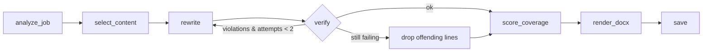

# CV Tailoring Agent

The search agent answers "which jobs?". This agent answers "how do I present myself for *this* job?". It is a separate graph because it runs on demand for a handful of jobs, has a different input (one job + the master CV) and a different output (documents), and needs a self-correction loop the search pipeline doesn't.

**Status: planned (Phase 8).** Until this graph exists, `jobhunter/handoff.py` covers the use case on the owner's Claude subscription: it writes a per-job brief (posting, analysis, CV, master CV, this skill's no-fabrication rule) and Claude Code or a claude.ai chat writes the documents (see the `apply` skill and ARCHITECTURE §15). Keep the two consistent: the rule and the output files (`changes.md`, gaps, cover letter) are the same.

## The non-negotiable rule: no fabrication
The tailored CV may **select, reorder, emphasize and rephrase** content from the master CV. It may **never add** a skill, tool, employer, title, date, number, degree or project that is not in the master CV. Reasons: the owner will be interviewed on every line, and a single invented claim costs more than any keyword gain. The `verify` node enforces this mechanically; do not weaken it to make output "better".

Allowed: using the job's wording for something the candidate genuinely did ("built a RAG pipeline" → "built a retrieval-augmented generation (RAG) system with hybrid search"), if the master CV supports every part of it.

## Input: the master CV — `cv/cv_master.yaml`
The one-page CV is too thin to tailor from. The master CV holds *everything*, so the agent has something to choose between. Schema and an example in `references/master-cv-schema.yaml`. Key ideas:
- Each experience/project has **many bullets** (6–10), each with `tags` (skills it proves) — the agent picks the 2–4 most relevant per job.
- `skills` grouped by category with a self-rated `level` (expert/strong/familiar) so the agent can't promote "familiar" to the top.
- Optional `variants` of the summary (AI-focused, backend-focused, data-focused) as starting points.

Bootstrap: on first use, if `cv_master.yaml` is missing, generate a draft from the CV text with the LLM (`references/prompts.md` → MASTER_DRAFT), save it, and **stop and tell the owner to review and enrich it** — the quality of every tailored CV depends on this file.

## Graph — `jobhunter/tailor/graph.py`



State: `job, master, requirements, selection, draft, violations, attempts, coverage_before, coverage_after, files`.

| Node | What it does |
|---|---|
| `analyze_job` | LLM → `JobRequirements`: must_have[], nice_to_have[], keywords[] (exact phrases as written in the posting, for ATS), seniority, domain, language of posting. |
| `select_content` | Mostly deterministic: rank master bullets by tag overlap with requirements (+ LLM tie-break optional); choose summary variant; order skills: matched must-haves first. Keeps the CV to one page (≈ 3 roles/projects × 2–4 bullets). |
| `rewrite` | LLM → `TailoredCV` (structured): headline, summary (3 lines), skills (ordered, grouped), selected entries with rewritten bullets — each bullet carries `source_ids` pointing to the master bullets it came from. |
| `verify` | Two layers. **Deterministic**: every skill in the output exists in the master skills; every bullet has valid `source_ids`; numbers/dates in a bullet appear in its sources. **LLM judge**: for each bullet, "is every claim supported by these source bullets? yes/no + unsupported phrase". Violations go back to `rewrite` with the exact offending phrases. Max 2 retries, then remove the offending lines rather than ship them. |
| `score_coverage` | Keyword coverage before (master one-pager) and after (tailored). |
| `render_docx` | Fill `cv/template.docx` with `docxtpl`; optional PDF via LibreOffice/docx2pdf on Windows. |
| `save` | Write files to `data/tailored/<company>_<title>_<date>/` and a row in `tailored_cvs`. |

Coverage, computed with the same skills/keyword matcher as `job-matching`:

$$
\text{coverage} = \frac{|K_{\text{job}} \cap K_{\text{cv}}|}{|K_{\text{job}}|}
$$

Show both numbers in the dashboard. A big jump is expected; if "after" is still low, the gap is real (skills you lack), and that is useful information too — list the uncovered must-haves as "missing".

## Outputs per job
- `CV_<Name>_<Company>.docx` (+ `.pdf` if enabled)
- `changes.md` — what was emphasized, reordered and rephrased, and why (one line each). The owner reads this in 30 seconds before sending.
- `cover_letter.md` — optional (config flag): 150–220 words, references 2 concrete things from the posting, same no-fabrication rule and verify step.
- `gaps.md` — must-haves not covered and suggested honest framing ("currently learning X", adjacent experience).

## Templates and ATS
- `cv/template.docx` is designed by the owner in Word with Jinja tags (`{{ headline }}`, ``…). docxtpl keeps the styling, so the look is controlled in Word, not code.
- ATS-friendly: single column, no tables for layout, no text in images/headers, standard section names (Summary, Skills, Experience, Projects, Education), dates as `MM/YYYY`.
- Language: match the posting language (Israeli tech postings are mostly English → English CV); Hebrew postings → ask in config whether to produce Hebrew.

## Triggers
- Dashboard: button "התאם קו"ח למשרה" in the job detail panel → runs the graph in a subprocess for that job id; shows progress and then download buttons + coverage before/after + `changes.md`.
- Automatic (config `tailoring.auto_min_score`, default off / e.g. 80): after the search pipeline's `save`, queue new jobs above the threshold, max `tailoring.auto_max_per_run` (e.g. 3).
- CLI: `python tailor_cv.py --job <id>` or `--top 3`.

## Config (add to `config.yaml`)
```yaml
tailoring:
  master_cv: cv/cv_master.yaml
  template: cv/template.docx
  output_dir: data/tailored
  cover_letter: true
  pdf: false
  auto_min_score: null      # e.g. 80 to tailor automatically
  auto_max_per_run: 3
  max_verify_retries: 2
```

## Storage
New table (add to `job-storage` schema):
```sql
CREATE TABLE IF NOT EXISTS tailored_cvs (
    id INTEGER PRIMARY KEY AUTOINCREMENT,
    job_id TEXT REFERENCES jobs(id),
    created TEXT, master_hash TEXT,
    coverage_before REAL, coverage_after REAL,
    violations_removed INTEGER, files TEXT  -- JSON list of paths
);
```
Re-tailoring the same job creates a new row (versions); the dashboard shows the latest.

## Tests (see `offline-testing`)
- A fixture job + fixture master CV + fake LLM that **injects a fabricated skill** in `rewrite` → `verify` catches it, retries, and the final output does not contain it. This is the most important test in the module.
- Deterministic verify: unknown skill, bullet without `source_ids`, number not in source → each flagged.
- Template renders with all sections and with optional sections empty.

Prompts: `references/prompts.md`.
