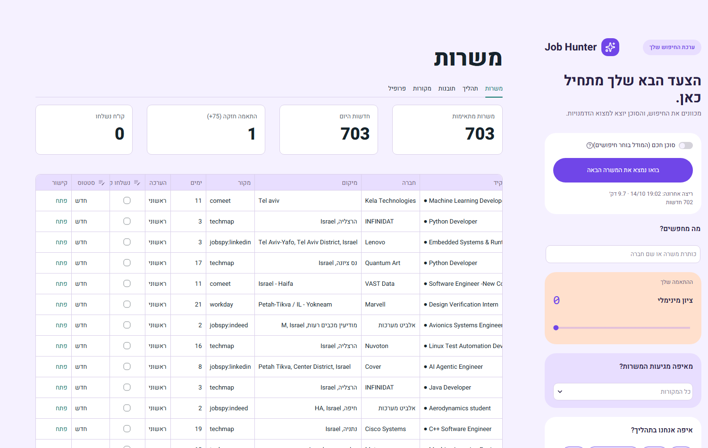
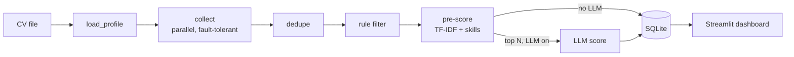

# Job Hunter Agent

[](https://github.com/GilRahamim/job-hunter-agent/actions/workflows/tests.yml)

A local AI agent that collects software, data and AI job postings (in Israel, plus remote jobs open to Israel), scores each one against your CV, and shows the results in a Streamlit dashboard where you track your applications.

Built with **LangGraph**, **LangChain**, **Pydantic**, **SQLite** and **Streamlit**. The LLM is optional: without an API key, everything still runs on a free heuristic score.

<picture>
  <source media="(prefers-color-scheme: dark)" srcset="docs/images/dashboard-dark.png">
  
</picture>

## What it does

1. **Collects** jobs in parallel from:
   - LinkedIn and Indeed (through [JobSpy](https://github.com/speedyapply/JobSpy))
   - About 240 company career boards on Greenhouse, Lever, Ashby, SmartRecruiters, Workday and Comeet
   - The Israeli Tech Map and VC portfolio job boards (Getro)
   - Remote boards: Remotive, RemoteOK, Himalayas, We Work Remotely, Arbeitnow
   - Google Jobs through SerpAPI (optional)
2. **Dedupes** the same job across boards and skips jobs it has already seen.
3. **Filters** by location (Israeli cities, including Hebrew names, or remote jobs open to Israel), role, seniority, required years and posting age.
4. **Pre-scores** every job for free with TF-IDF and skill overlap against the CV.
5. **LLM-scores** only the top N jobs and returns a structured `JobMatch`: a score, the reasoning, missing skills and a CV tip.
6. **Saves** to SQLite. Re-runs never overwrite your own `status` and `notes`.
7. **Shows** everything in a Hebrew (RTL) Streamlit dashboard with a jobs table, inline status editing, an application pipeline, skill-gap insights and source health.
8. **Learns from your choices.** Jobs you mark interested/applied or not relevant are shown to the LLM as hints when it scores the next ones.
9. **Hands the writing to Claude on your subscription.** For a job you pick, it prepares a brief (posting, match analysis, CV, rules) and opens Claude Code on it, or you attach it to a claude.ai chat. Claude writes a tailored CV, a cover letter, interview prep and a list of changes and gaps, and adds nothing that is not in your CV. It runs on your Claude plan, not the API.
10. **Works for more than one person.** Anyone on the same PC can add themselves by uploading a CV. They get their own jobs, statuses and settings, and their search terms come from their CV.



### Two ways to run the search

- **Fixed pipeline (default).** A LangGraph `StateGraph` with one conditional edge (LLM or no LLM). It is repeatable, cheap and easy to test.
- **Agent loop (`--agent`).** A ReAct-style loop in which the model writes its own searches with the tools `search_jobs`, `read_posting` and `save_match`, and stops once it has saved N good matches. The guardrails live in code, not in the prompt: step and search budgets, a job must be read before it can be saved, filtered jobs are never shown to the model, and searches must cover every role group.

## Quick start

Requires Python 3.11+. Developed on Windows.

```bash
pip install -r requirements.txt          # requirements-dev.txt adds pytest and the design tools
```

1. Open the dashboard with `streamlit run dashboard.py` and upload your CV (PDF, DOCX or TXT, in Hebrew or English) in the **Profile** tab, or put it in `cv/` yourself. The newest file is used.
2. Optional, to use an LLM: copy `.env.example` to `.env` and add your key (for example `ANTHROPIC_API_KEY=...`). Set the provider and model under `llm:` in `config.yaml`.
3. Click **"בואו נמצא את המשרה הבאה"** in the sidebar, or run `python run_agent.py --no-llm` for a free first run.

A step-by-step guide in Hebrew, for anyone who just wants to use the tool, is in [`docs/USER_GUIDE.he.md`](docs/USER_GUIDE.he.md).

## Usage

```bash
python run_agent.py                         # full run: collect, filter, score, save
python run_agent.py --no-llm                # heuristic scores only (free)
python run_agent.py --sources ats,remotive --limit 50   # partial run
python run_agent.py --dry-run               # no DB writes; prints the top 15
python run_agent.py --rescore               # re-score stored jobs against the current CV
python run_agent.py --check-companies       # validate companies.yaml
python run_agent.py --agent --goal 5        # tool-using agent loop
python run_agent.py --user dana             # run for a person added in the dashboard
python -m jobhunter.handoff --list          # best jobs and their ids
python -m jobhunter.handoff <job_id> --launch   # brief for Claude, open Claude Code on it
streamlit run dashboard.py                  # dashboard
pytest -q                                   # tests (offline, recorded fixtures)
```

### Preparing an application with Claude (subscription, not API)

In a job's card, open **"הכנת מועמדות עם Claude"** and click **"הכנת תיק למשרה"**. This writes `data/tailored/<job>/brief.md`. From there:

- **"פתיחה ב-Claude Code"** (Windows and macOS) opens Claude Code in a new window on the brief. The button removes `ANTHROPIC_API_KEY` and `ANTHROPIC_AUTH_TOKEN` from that window's environment: the dashboard has `.env` loaded, and when Claude Code finds an API key in its environment it asks to use it instead of your subscription (once approved, it bills the API).
- **"הורדת התיק ל-claude.ai"** downloads the brief to attach to a claude.ai chat.
- Inside Claude Code you can also type `/apply <job_id>`.

Claude saves `cv_tailored.md` (plus a `.docx` copy), `cover_letter.md`, `interview_prep.md` and `changes.md` next to the brief, and the dashboard lists them for download. The brief forbids adding any skill, employer, date or number that is not in the CV.

### Several people on one PC

Profile tab → **"הוספת אדם נוסף"**: a name, a CV and, optionally, job titles. This creates `users/<id>/` (gitignored) with that person's CV, their own `jobs.db` and run files, and a `config.yaml` that holds only what differs from the main one. That file turns on `auto_from_cv`: the search titles, the role filter and the experience limit come from their CV (`jobhunter/personalize.py`), because the main `config.yaml` is tuned for the owner's junior CS search. Without an LLM, the titles typed in the form are used. Pick who is searching at the top of the sidebar. Schedule a daily run for them with `scripts\schedule_windows.ps1 -User <id>`. The tool-using agent loop stays the owner's.

A full run takes a few minutes. Most of that time is JobSpy, which waits between queries so LinkedIn does not rate-limit it.

### Daily run on Windows

```powershell
powershell -ExecutionPolicy Bypass -File scripts\schedule_windows.ps1            # every day at 08:30
powershell -ExecutionPolicy Bypass -File scripts\schedule_windows.ps1 -At 7:15am
powershell -ExecutionPolicy Bypass -File scripts\schedule_windows.ps1 -RunNow
powershell -ExecutionPolicy Bypass -File scripts\schedule_windows.ps1 -Remove
```

This registers a Task Scheduler task named `JobHunterAgent`. If the PC was off at the scheduled time, the run starts when it turns on. Logs go to `data/logs/`.

## Configuration

All settings live in `config.yaml`:

| Section | What it controls |
|---|---|
| `profile` | Manual corrections to the skills and seniority extracted from the CV (`profile.overrides`) |
| `filters` | Location, roles, seniority, `max_required_years` (0 = junior only; `null` = no limit) |
| `search` | Queries and `results_per_query` |
| `sources` | Which collectors run, and their options |
| `matching` | `llm_top_n` (how many jobs go to the LLM), `fetch_descriptions`, `feedback_examples` (how many of your marked jobs the LLM sees) |
| `agent` | Agent-loop goal, budgets, role groups and an optional separate model |
| `notify` | Desktop notification for new jobs scoring at or above `min_score` |
| `llm` | Provider and model (`provider: none` turns the LLM off) |
| `users/<id>/config.yaml` | Per-person overrides on top of `config.yaml` (`display_name`, `auto_from_cv`, `search.queries`) |

To add companies, put their slugs in `companies.yaml` and run `--check-companies`. `scripts/sync_companies.py` pulls new boards from the Israeli Tech Map and VC job boards.

## Project layout

```
run_agent.py        CLI entry point
dashboard.py        Streamlit app
config.yaml         settings
companies.yaml      company career boards
jobhunter/
  agent.py          LangGraph pipeline
  agent_loop/       tool-using agent loop
  collectors/       one module per source; each returns list[Job] and never raises
  filters.py        location / role / seniority / age rules
  dedupe.py         same posting / same role on several boards
  matcher.py        pre-score + parallel LLM scoring
  prompts.py        every LLM prompt in one place (and the Claude brief)
  cv.py             CV parsing and profile extraction (cached by file hash)
  db.py             SQLite schema, upserts, run history
  handoff.py        one job -> brief for Claude Code / claude.ai, Markdown -> Word
  users.py          people added from the dashboard (users/<id>/)
  personalize.py    search settings derived from a CV (auto_from_cv)
  runlock.py stop.py  one run at a time, graceful stop
ui/                 dashboard design system (tokens, CSS, components)
scripts/            board checks, company sync, Windows scheduling
tests/              pytest suite with recorded API responses and a fake LLM
docs/               architecture, implementation plan, Hebrew user guide
```

See [`docs/ARCHITECTURE.md`](docs/ARCHITECTURE.md) for the data model, the scoring formula and the design decisions.

## Design choices

- **One broken site never stops a run.** Every collector catches its own errors and reports them in a source-health record, which the dashboard shows.
- **The LLM sees only pre-scored jobs.** Only the top N go to the model, which keeps runs cheap and fast.
- **Your data is protected.** Collecting or re-scoring never touches `status` or `notes`.
- **Offline tests.** The test suite runs on recorded fixtures and a deterministic fake LLM, so it makes no network or API calls. GitHub Actions runs it on every push and pull request (Ubuntu with Python 3.11 and 3.13, Windows with Python 3.13).

## Troubleshooting

- **`401 invalid x-api-key`**: the key is wrong or was revoked. Create a new one.
- **`not scoped to a workspace`**: set `llm.anthropic_workspace_id` in `config.yaml`, or create the key inside a workspace.
- **LinkedIn returns 429**: LinkedIn rate-limits fast requests. The run continues with the other sources. Lower `search.results_per_query`.
- **"another run is in progress"**: another run holds the lock. If it is stuck, delete `data/run.lock` (`users/<id>/data/run.lock` for another person).
- **Claude Code bills the API instead of the subscription**: start it from the dashboard button, or run `claude` from a terminal where `ANTHROPIC_API_KEY` is not set. `/status` inside Claude Code shows which login it uses.
- **Theme changes do not show**: restart Streamlit.

## Roadmap

- **CV Tailoring Agent (Phase 8, planned):** a second LangGraph agent that tailors the CV through the API, with a mechanical fact-check loop and a Word template. Until then, the Claude handoff above does this job on your subscription.
- Direct collectors for AllJobs and Drushim. Today their jobs arrive only when Google Jobs lists them.
- More ideas, ranked, at the end of [`docs/IMPLEMENTATION_PLAN.md`](docs/IMPLEMENTATION_PLAN.md).
