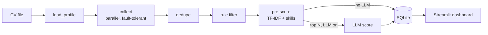

# Job Hunter Agent

A local AI agent that collects software, data and AI job postings (in Israel, plus remote jobs open to Israel), scores each one against your CV, and shows the results in a Streamlit dashboard where you track your applications.

Built with **LangGraph**, **LangChain**, **Pydantic**, **SQLite** and **Streamlit**. The LLM is optional: without an API key, everything still runs on a free heuristic score.

## What it does

1. **Collects** jobs in parallel from:
   - LinkedIn and Indeed (through [JobSpy](https://github.com/speedyapply/JobSpy))
   - About 240 company career boards on Greenhouse, Lever, Ashby, SmartRecruiters, Workday and Comeet
   - The Israeli Tech Map and VC portfolio job boards (Getro)
   - Remote boards: Remotive, RemoteOK, Himalayas, We Work Remotely, Arbeitnow
   - Google Jobs through SerpAPI (optional)
2. **Dedupes** the same job across boards and skips jobs it has already seen.
3. **Filters** by location (Israeli cities, including Hebrew names, or remote jobs open to Israel), role, seniority, required years and posting age.
4. **Pre-scores** every job for free with TF-IDF and skill overlap against the CV.
5. **LLM-scores** only the top N jobs and returns a structured `JobMatch`: a score, the reasoning, missing skills and a CV tip.
6. **Saves** to SQLite. Re-runs never overwrite your own `status` and `notes`.
7. **Shows** everything in a Hebrew (RTL) Streamlit dashboard with a jobs table, inline status editing, an application pipeline, skill-gap insights and source health.



### Two ways to run the search

- **Fixed pipeline (default).** A LangGraph `StateGraph` with one conditional edge (LLM or no LLM). It is repeatable, cheap and easy to test.
- **Agent loop (`--agent`).** A ReAct-style loop in which the model writes its own searches with the tools `search_jobs`, `read_posting` and `save_match`, and stops once it has saved N good matches. The guardrails live in code, not in the prompt: step and search budgets, a job must be read before it can be saved, filtered jobs are never shown to the model, and searches must cover every role group.

## Quick start

Requires Python 3.11+. Developed on Windows.

```bash
pip install -r requirements.txt
```

1. Put your CV (PDF, DOCX or TXT, in Hebrew or English) in `cv/`. The newest file is used.
2. Optional, to use an LLM: copy `.env.example` to `.env` and add your key (for example `ANTHROPIC_API_KEY=...`). Set the provider and model under `llm:` in `config.yaml`.
3. Run it:

```bash
python run_agent.py --no-llm        # first run, free
streamlit run dashboard.py          # open the dashboard
```

## Usage

```bash
python run_agent.py                         # full run: collect, filter, score, save
python run_agent.py --no-llm                # heuristic scores only (free)
python run_agent.py --sources ats,remotive --limit 50   # partial run
python run_agent.py --dry-run               # no DB writes; prints the top 15
python run_agent.py --rescore               # re-score stored jobs against the current CV
python run_agent.py --check-companies       # validate companies.yaml
python run_agent.py --agent --goal 5        # tool-using agent loop
streamlit run dashboard.py                  # dashboard
pytest -q                                   # tests (offline, recorded fixtures)
```

A full run takes a few minutes. Most of that time is JobSpy, which waits between queries so LinkedIn does not rate-limit it.

### Daily run on Windows

```powershell
powershell -ExecutionPolicy Bypass -File scripts\schedule_windows.ps1            # every day at 08:30
powershell -ExecutionPolicy Bypass -File scripts\schedule_windows.ps1 -At 7:15am
powershell -ExecutionPolicy Bypass -File scripts\schedule_windows.ps1 -RunNow
powershell -ExecutionPolicy Bypass -File scripts\schedule_windows.ps1 -Remove
```

This registers a Task Scheduler task named `JobHunterAgent`. If the PC was off at the scheduled time, the run starts when it turns on. Logs go to `data/logs/`.

## Configuration

All settings live in `config.yaml`:

| Section | What it controls |
|---|---|
| `profile` | Manual corrections to the skills and seniority extracted from the CV (`profile.overrides`) |
| `filters` | Location, roles, seniority, `max_required_years` (0 = junior only; `null` = no limit) |
| `search` | Queries and `results_per_query` |
| `sources` | Which collectors run, and their options |
| `matching` | Pre-score weights and `llm_top_n` (how many jobs go to the LLM) |
| `agent` | Agent-loop goal, budgets, role groups and an optional separate model |
| `notify` | Desktop notification for new jobs scoring at or above `min_score` |
| `llm` | Provider and model (`provider: none` turns the LLM off) |

To add companies, put their slugs in `companies.yaml` and run `--check-companies`. `scripts/sync_companies.py` pulls new boards from the Israeli Tech Map and VC job boards.

## Project layout

```
run_agent.py        CLI entry point
dashboard.py        Streamlit app
config.yaml         settings
companies.yaml      company career boards
jobhunter/
  agent.py          LangGraph pipeline
  agent_loop/       tool-using agent loop
  collectors/       one module per source; each returns list[Job] and never raises
  filters.py        location / role / seniority / age rules
  matcher.py        pre-score + parallel LLM scoring
  prompts.py        every LLM prompt in one place
  cv.py             CV parsing and profile extraction (cached by file hash)
  db.py             SQLite schema, upserts, run history
ui/                 dashboard design system (tokens, CSS, components)
scripts/            board checks, company sync, Windows scheduling
tests/              pytest suite with recorded API responses and a fake LLM
docs/               architecture and implementation plan
```

See [`docs/ARCHITECTURE.md`](docs/ARCHITECTURE.md) for the data model, the scoring formula and the design decisions.

## Design choices

- **One broken site never stops a run.** Every collector catches its own errors and reports them in a source-health record, which the dashboard shows.
- **The LLM sees only pre-scored jobs.** Only the top N go to the model, which keeps runs cheap and fast.
- **Your data is protected.** Collecting or re-scoring never touches `status` or `notes`.
- **Offline tests.** The test suite runs on recorded fixtures and a deterministic fake LLM, so it makes no network or API calls.

## Troubleshooting

- **`401 invalid x-api-key`**: the key is wrong or was revoked. Create a new one.
- **`not scoped to a workspace`**: set `llm.anthropic_workspace_id` in `config.yaml`, or create the key inside a workspace.
- **LinkedIn returns 429**: LinkedIn rate-limits fast requests. The run continues with the other sources. Lower `search.results_per_query`.
- **"another run is in progress"**: another run holds the lock. If it is stuck, delete `data/run.lock`.
- **Theme changes do not show**: restart Streamlit.

## Roadmap

- **CV Tailoring Agent:** a second LangGraph agent that writes a version of the CV for a chosen job from a master CV. A fact-check loop will forbid any claim that is not in the master CV, and the output will be a DOCX built from a Word template.
- Direct collectors for AllJobs and Drushim. Today their jobs arrive only when Google Jobs lists them.
