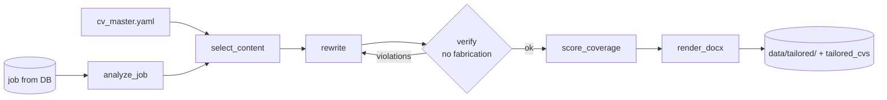

# Architecture — Job Hunter Agent

## 1. Goal and scope
Find every relevant development job (AI/GenAI, ML, Python/backend, full stack, data science/analysis, general software) that is either **located in Israel** or **remote and open to candidates in Israel**, rank it against the owner's CV, and present it in a dashboard that doubles as an application tracker.

Non-goals (v1): auto-applying, writing cover letters automatically, multi-user support, cloud hosting.

## 2. High-level flow

```mermaid
flowchart LR
    CV[cv/ PDF/DOCX] --> P[load_profile<br/>LLM → CandidateProfile<br/>cached by file hash]
    subgraph Collect [collect — parallel, fault-tolerant]
        JS[JobSpy<br/>LinkedIn · Indeed · Glassdoor · Google]
        ATS[Company boards<br/>Greenhouse · Lever · Ashby · SmartRecruiters · Workday]
        RB[Remote boards<br/>Remotive · RemoteOK · Himalayas · WWR · Arbeitnow]
        SA[SerpAPI Google Jobs<br/>optional]
    end
    P --> Collect
    Collect --> N[normalize + dedupe<br/>skip already-known jobs]
    N --> F[rule filter<br/>location · role · seniority · age]
    F --> PS[pre-score<br/>TF-IDF + skill overlap]
    PS -->|top N, LLM available| LS[LLM score<br/>structured JobMatch]
    PS -->|no LLM| SV
    LS --> SV[(SQLite<br/>data/jobs.db)]
    SV --> D[Streamlit dashboard<br/>filter · review · track status]
```



The pipeline is a **LangGraph `StateGraph`** (see the `agent-pipeline` skill). It is deterministic orchestration with one conditional edge (LLM or not) — not a free-roaming ReAct agent. That is deliberate: the job is a repeatable batch process, and a fixed graph is cheaper, testable, and debuggable. The "agentic" part is the LLM judgement inside `llm_score` and `load_profile`.

### Second agent: CV Tailoring
A separate LangGraph graph (`jobhunter/tailor/`) that runs **on demand per job** — dashboard button, CLI, or automatically for new jobs above `tailoring.auto_min_score`. It reads the job from the DB and the owner's **master CV** (`cv/cv_master.yaml`, richer than the one-page CV), and writes a tailored DOCX, `changes.md`, `gaps.md` and an optional cover letter.



Why a separate agent and not a node in the search pipeline: different trigger (per job, on demand), different input and output, and it needs a self-correction loop (`verify → rewrite`). The two agents share only the DB. Details in the `cv-tailoring` skill.

### Search agent loop (`run_agent.py --agent`)
An opt-in alternative to the fixed pipeline (`jobhunter/agent_loop/`): a ReAct-style LangGraph loop in which the **model chooses the next action**. Tools: `get_profile`, `search_jobs(query, source)`, `read_posting(job_id)`, `save_match(job_id, score, reason)`. Goal: `agent.goal_matches` saved jobs scoring ≥ `agent.min_match_score`.


Guardrails stay in code, outside the model's control: dedupe vs DB and the rule filters run inside `search_jobs` (filtered jobs are never shown to the model); budgets `max_steps` and `max_searches`; a job must be read before it is saved; tool-argument validation errors go back to the model instead of crashing; a model/provider error ends the loop but keeps what was found. Only `linkedin` (JobSpy) searches by the model's query; `company_pages` and `remote_boards` fetch their lists once per run and match the query against titles. Role coverage is enforced in code too: `agent.role_groups` (AI/ML, Data, Software, Algorithms, Automation/QA/DevOps) is listed in the prompt, each search is mapped to its group(s), `max_searches_per_group` caps any one group, and every search result names the groups not searched yet — so an AI-leaning CV still gets Data and Software searches. The model scores real skills rather than CV wording, since the CV Tailoring Agent adapts the CV per saved job. Saved jobs get `scored_by = 'agent:<model>'`; other candidates seen are stored with their heuristic pre-score. `status`/`notes` are never written. `agent.llm` can override the model for the agent only (e.g. a local Ollama model with tool calling). The dashboard sidebar can start it too: a "smart agent" toggle with a goal slider (3–10, default `agent.goal_matches`) runs `run_agent.py --agent --goal N`, and the button is disabled with a warning when the local model server (`agent.llm.base_url`) does not answer. Without an LLM the agent refuses to run; the fixed pipeline remains the default and the fallback.

## 3. Components

| Module | Responsibility | Skill |
|---|---|---|
| `config.py` | Load `config.yaml`, `companies.yaml`, `.env` | — |
| `models.py` | `Job` dataclass, `CandidateProfile`, `JobMatch` (Pydantic) | `job-matching` |
| `collectors/*` | One function per source → `list[Job]` + health record | `job-sources` |
| `cv.py` | Read CV text, extract `CandidateProfile`, cache by hash | `cv-profile` |
| `filters.py` | Location / role / seniority / age rules | `job-matching` |
| `matcher.py` | Pre-score + LLM scoring (parallel, retries) | `job-matching` |
| `prompts.py` | All LLM prompts | `job-matching`, `cv-profile` |
| `llm.py` | `get_llm()` via `init_chat_model`; returns `None` when disabled | `agent-pipeline` |
| `db.py` | Schema, upserts, status updates, run history | `job-storage` |
| `agent.py` | LangGraph graph definition and `run()` | `agent-pipeline` |
| `run_agent.py` | CLI flags | `agent-pipeline` |
| `dashboard.py` | Streamlit UI | `job-dashboard` |
| `tailor/*`, `tailor_cv.py` | CV Tailoring Agent (second graph) | `cv-tailoring` |

## 4. Core data model

```python
@dataclass
class Job:
    source: str; title: str; company: str; url: str
    location: str = ""; description: str = ""
    is_remote: bool = False; remote_region: str = ""   # e.g. "Worldwide", "USA only"
    date_posted: str | None = None                     # ISO date
    id      -> sha1(url.lower())[:16]
    dedupe_key -> normalized "company|title"           # same role on several boards
```

`CandidateProfile` (from CV): name, headline, summary, years_experience, seniority, skills[], target_roles[], education[], projects[], languages[].

`JobMatch` (from LLM): score 0–100, verdict (strong/good/stretch/poor), seniority_fit, required_years, matching_skills[], missing_skills[], reasons, cv_tip.

## 5. Scoring

**Stage 1 — rule filter** (cheap, removes ~70–90%): location is Israel *or* remote with an acceptable region; title matches a role keyword; title does not match exclude keywords; optionally drop senior titles; drop postings older than `max_age_days`.

**Stage 2 — pre-score** (no API cost), for every job that passed:

$$
\text{prescore} = 100\cdot\Big(w_t\cdot \tilde{s}_{\text{tfidf}} + w_k\cdot \frac{|K_{\text{cv}} \cap K_{\text{job}}|}{\max(1,\,|K_{\text{job}}|)}\Big) - \text{penalty}_{\text{seniority}}
$$

where $\tilde{s}_{\text{tfidf}}$ is the cosine similarity between the profile text and the job text, min–max normalized across the batch, $K$ are skill sets found by matching a skills vocabulary, and defaults are $w_t = 0.6,\ w_k = 0.4$.

**Stage 3 — LLM score**: only the top `llm_top_n` jobs with $\text{prescore} \ge$ `min_prescore_for_llm` go to the LLM, which returns a `JobMatch` via structured output. The final `score` shown in the dashboard is the LLM score when present, else the pre-score (and `scored_by` records which).

Re-scoring: when the CV file hash changes, jobs scored with the old hash and not marked rejected/not-relevant are re-scored.

## 6. Storage (SQLite)
Tables: `jobs`, `runs`, `source_health`, `profile`. Full schema in the `job-storage` skill. Key rules:
- `id` = hash of URL (primary key); `dedupe_key` catches the same role across boards.
- Collection/scoring never touch `status`, `notes`, `status_updated`.
- `last_seen` is refreshed every run; jobs not seen for 14 days are shown as "possibly closed".

## 7. Dashboard
Streamlit, Hebrew UI with RTL CSS. Pages/tabs: Jobs (filterable table + detail panel with reasons, skills, status, notes, apply link), Pipeline (counts by status), Insights (score distribution, jobs per source, **top missing skills across good matches** — the learning roadmap), Sources (health of last run), Profile (extracted CV profile). Sidebar button triggers a run in a subprocess.

## 8. Scheduling
Windows Task Scheduler runs `python run_agent.py` daily (script in `scripts/schedule_windows.ps1`). The dashboard is opened on demand.

## 9. Key decisions and tradeoffs

| Decision | Chosen | Alternative | Why |
|---|---|---|---|
| LinkedIn/Indeed/Glassdoor | JobSpy library | Own scraper / paid API | Maintained by others, free; risk: sites can block it → isolated per-source failure |
| Company sites | Public ATS JSON APIs | HTML scraping | Stable, official, full descriptions; covers only listed companies → extend `companies.yaml` |
| Orchestration | Fixed LangGraph graph | ReAct agent with tools | Repeatable batch job; cheaper and testable |
| Pre-score | TF-IDF + skill overlap | Embeddings (sentence-transformers) | No model download, fast; embeddings can be added later behind the same interface |
| LLM | `init_chat_model` (Anthropic default, any provider, or none) | One vendor SDK | Swap providers via config; works offline |
| Storage | SQLite | Postgres / ChromaDB | Single user, zero setup, easy to inspect |
| UI | Streamlit | React | Fast to build in Python; good enough for one user |

## 10. Cost and runtime (order of magnitude)
Per daily run: a few hundred to ~2,000 raw postings → a few hundred after filtering → `llm_top_n` (default 60) LLM calls of roughly 2–3k input tokens and ~400 output tokens each. Check current model pricing before raising `llm_top_n`. JobSpy is the slowest source (rate-limited); a full run should take a few minutes.

## 11. Known limitations
- AllJobs, Drushim and similar Israeli boards have no public API; their postings are reached indirectly via Google Jobs (JobSpy `google` site or SerpAPI). Direct scrapers can be added later as separate collectors.
- Comeet-hosted companies (common in Israel) need a per-company uid + token read from their careers page; a Comeet collector is planned but not yet verified, so for now they are reached via JobSpy/Google.
- Seniority detection from titles is imperfect; the LLM's `seniority_fit` is the more reliable signal.

## 12. Junior-only mode
The owner wants junior / entry-level roles only. One check, `filters.junior_reason(job, cfg)`, decides it and is shared by the filter stage, the rescore step (old DB jobs are not scored again if they fail it), the agent's `save_match` guard and the dashboard's junior toggle. A job fails as:
- `senior`: title has a `senior_keywords` word (incl. lead/leader, II/III/IV, expert).
- `experience`: states more than `max_required_years` (0) years, or `junior_max_required_years` (1) when the title has a `junior_keywords` word; or uses an `experienced_phrases` phrase ("proven experience", "ניסיון רב") without a junior title. Years parsing reads digits, number words ("four years") and Hebrew ("שנתיים", "שנת ניסיון").
- `unverified` (`drop_unverified`): no description and no junior word in the title, so the requirement cannot be checked. The fixed pipeline's LinkedIn results have no description (`fetch_linkedin_descriptions: false`), so most of them drop here; the agent fetches LinkedIn descriptions for its own searches.

The agent also prefixes LinkedIn queries that have no junior word with `agent.junior_query_prefix` ("AI Engineer" → "Junior AI Engineer"), shows junior signals in search results and postings, and its system prompt lists the junior keywords. `search.queries` for the fixed pipeline use junior wording too.

## 13. Stopping a run from the dashboard
While a run is going, the sidebar shows a "עצירת החיפוש" toggle. It writes `data/stop.flag` (`jobhunter/stop.py`); the run checks it between steps and ends cleanly, keeping what it found: the agent loop stops before its next model call or after the current tool (`stop_reason: stopped_by_user`), JobSpy skips its remaining queries, and the fixed pipeline skips LLM scoring and saves heuristic scores. Switching the toggle off before the run ends cancels the request. If the run is still alive 60 s after the request, an "עצירה מיידית" button kills the process (that run's results are lost). `run_lock` removes the flag when a run ends, and at start removes only a flag older than 5 minutes, so a stop requested while the run is starting still counts.
