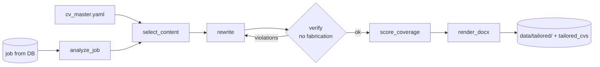
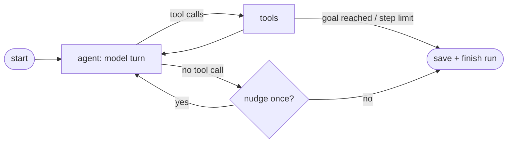
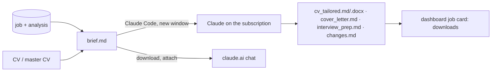

# Architecture — Job Hunter Agent

## 1. Goal and scope
Find every relevant development job (AI/GenAI, ML, Python/backend, full stack, data science/analysis, general software) that is either **located in Israel** or **remote and open to candidates in Israel**, rank it against the owner's CV, and present it in a dashboard that doubles as an application tracker.

Non-goals (v1): auto-applying, accounts and logins, cloud hosting. Several people on one PC are supported through separate folders (§14); cover letters are written by Claude on request (§15), never sent automatically.

## 2. High-level flow

```mermaid
flowchart LR
    CV[cv/ PDF/DOCX] --> P[load_profile<br/>LLM → CandidateProfile<br/>cached by file hash]
    subgraph Collect [collect — parallel, fault-tolerant]
        JS[JobSpy<br/>LinkedIn · Indeed]
        ATS[Company boards<br/>Greenhouse · Lever · Ashby · SmartRecruiters · Workday]
        RB[Remote boards<br/>Remotive · RemoteOK · Himalayas · WWR · Arbeitnow]
        SA[SerpAPI Google Jobs<br/>optional]
    end
    P --> Collect
    Collect --> N[normalize + dedupe<br/>skip already-known jobs]
    N --> F[rule filter<br/>location · role · seniority · age]
    F --> PS[pre-score<br/>TF-IDF + skill overlap]
    PS -->|top N, LLM available| LS[LLM score<br/>structured JobMatch]
    PS -->|no LLM| SV
    LS --> SV[(SQLite<br/>data/jobs.db)]
    SV --> D[Streamlit dashboard<br/>filter · review · track status]
```



The pipeline is a **LangGraph `StateGraph`** (see the `agent-pipeline` skill). It is deterministic orchestration with one conditional edge (LLM or not) — not a free-roaming ReAct agent. That is deliberate: the job is a repeatable batch process, and a fixed graph is cheaper, testable, and debuggable. The "agentic" part is the LLM judgement inside `llm_score` and `load_profile`.

### Second agent: CV Tailoring (planned, Phase 8; not built yet)
`jobhunter/tailor/` is an empty package and `tailor_cv.py` does not exist yet; until it does, the Claude handoff (§15) covers the same need on the person's Claude subscription. The design below stays the plan for an API-driven, mechanically fact-checked version.

A separate LangGraph graph (`jobhunter/tailor/`) that runs **on demand per job** — dashboard button, CLI, or automatically for new jobs above `tailoring.auto_min_score`. It reads the job from the DB and the owner's **master CV** (`cv/cv_master.yaml`, richer than the one-page CV), and writes a tailored DOCX, `changes.md`, `gaps.md` and an optional cover letter.



Why a separate agent and not a node in the search pipeline: different trigger (per job, on demand), different input and output, and it needs a self-correction loop (`verify → rewrite`). The two agents share only the DB. Details in the `cv-tailoring` skill.

### Search agent loop (`run_agent.py --agent`)
An opt-in alternative to the fixed pipeline (`jobhunter/agent_loop/`): a ReAct-style LangGraph loop in which the **model chooses the next action**. Tools: `get_profile`, `search_jobs(query, source)`, `read_posting(job_id)`, `save_match(job_id, reason)`. Goal: `agent.goal_matches` saved jobs scoring ≥ `agent.min_match_score`. A reading guide for this code (commands with flags, reading order, where each feature lives) is in `docs/SMART_AGENT_GUIDE.md`.



Guardrails stay in code, outside the model's control: dedupe vs DB and the rule filters run inside `search_jobs` (filtered jobs are never shown to the model), and each new candidate's `company|title` key is added to the known keys, so the same role found later on another source in the same run is hidden too; budgets `max_steps` and `max_searches`; a job must be read in an earlier tool turn before it is saved (a `read_posting` + `save_match` pair in one batch is refused, because the model has not seen the text yet); tool-argument validation errors go back to the model instead of crashing; a model/provider error ends the loop but keeps what was found. Only `linkedin` (JobSpy) searches by the model's query; `company_pages` and `remote_boards` fetch their lists once per run and match the query against titles. Only the first load of such a list is charged to `max_searches`; later searches on it are free (stats: `searches` = all, `charged_searches` = against the budget).

Steps: `max_steps` counts model turns, and the prompt asks the model to batch tool calls (read 2–4 postings in one turn, save them in the next), so a match costs about one turn instead of two. `compact_history` trims only the model's view (the graph state keeps everything): everything from the latest tool turn stays as it is; before it, postings are cut to their header (except the last `KEEP_FULL_POSTINGS`), search results lose the rows of jobs already read and their stale "role groups not searched yet" note, and model replies lose `<think>` blocks and are cut to `MAX_OLD_TEXT` characters (string content only; provider content blocks are left alone).

Scoring: the agent picks, a scorer scores. `save_match` runs the regular search's scoring prompt and rubric (`matcher.llm_score`) on the job right away, so the goal check and the reply to the model ("Scorer: 72 (good). Missing: …") use that score, and saved rows carry the full `JobMatch` (reasons, matching/missing skills, CV tip) on the same scale as pipeline rows. `agent.scorer: main` (default) scores with the `llm` section (e.g. the API model that scores the regular search); `agent` uses the agent's own model (free when local); `main` falls back to the agent's model when `llm` is off. The scorer's `required_years` gets the pipeline's backstop: over the limit, the save is refused (`save_refused_experience_llm`). If scoring fails, the job is still stored with its pre-score and the agent's reason, but does not count toward the goal. Stats record the `scorer` model; scoring errors join `errors`.

Memory across runs (`agent_loop/memory.py`): each agent run stores per-search results in `runs.stats.queries` (`query, source, found, new, read, saved, strong`; no schema change). The next run's start message adds `AGENT_MEMORY`: totals per query+source over the last `agent.memory_runs` agent runs (default 5, 0 = off), split into queries that led to saved jobs and ones that did not. `new` counts jobs not stored before, so it also shows when a good query is exhausted. Pipeline runs and dry runs are not part of it. The same history is summed per role group (`memory.group_history`, via `query_groups`): the system prompt shows each group's recent searches / saved / strong next to its titles, and a group searched at least `agent.dry_group_searches` times (default 3, 0 = off) without one strong match is DRY: `group_cap` gives it one search this run instead of `max_searches_per_group`, so the budget goes to groups that produce matches while every group is still covered.

Stopping: when the model replies without a tool call, it is nudged once unless the last line of its reply (`<think>` removed) is exactly `DONE` (`said_done`); "I'm done with Data" gets the nudge.

Measuring the picks: `scripts/agent_report.py` compares what the agent saved with what the owner did in the dashboard: pursued (interested/applied/interview/offer/rejected) vs dismissed (not relevant), and precision = pursued / judged, by picker (agent / regular LLM search / heuristic), by score band (≥ `agent.min_match_score`) and, for agent picks, by role group. `--since` limits it to jobs first seen after a date, e.g. to compare before and after a change.

 Role coverage is enforced in code too: `agent.role_groups` (AI/ML, Data, Software, Algorithms, Automation/QA/DevOps) is listed in the prompt, each search is mapped to its group(s), `max_searches_per_group` caps any one group, and every search result names the groups not searched yet — so an AI-leaning CV still gets Data and Software searches. The model picks by real skills rather than CV wording, since the CV Tailoring Agent adapts the CV per saved job. Saved jobs get `scored_by = 'agent:<model>'` (the agent's model; the score is the scorer's); other candidates seen are stored with their heuristic pre-score. `status`/`notes` are never written. `agent.llm` can override the model for the agent only (e.g. a local Ollama model with tool calling). The dashboard sidebar can start it too: a "smart agent" toggle with a goal slider (3–10, default `agent.goal_matches`) runs `run_agent.py --agent --goal N`, and the button is disabled with a warning when the local model server (`agent.llm.base_url`) does not answer. Without an LLM the agent refuses to run; the fixed pipeline remains the default and the fallback.

## 3. Components

| Module | Responsibility | Skill |
|---|---|---|
| `config.py` | Load `config.yaml` (+ a user's overlay), `companies.yaml`, `.env`; per-user folders | — |
| `models.py` | `Job` dataclass, `CandidateProfile`, `JobMatch` (Pydantic) | `job-matching` |
| `dedupe.py` | Same posting / same role on several boards; source priority | `job-storage` |
| `runlock.py`, `stop.py` | One run at a time (`run.lock`), graceful stop (`stop.flag`) | `agent-pipeline` |
| `users.py`, `personalize.py` | People added from the dashboard; search settings derived from a CV | — |
| `handoff.py` | One job → brief for Claude Code / claude.ai; Markdown → Word | `apply` |
| `collectors/*` | One function per source → `list[Job]` + health record | `job-sources` |
| `cv.py` | Read CV text, extract `CandidateProfile`, cache by hash | `cv-profile` |
| `filters.py` | Location / role / seniority / age rules | `job-matching` |
| `matcher.py` | Pre-score + LLM scoring (parallel, retries) | `job-matching` |
| `prompts.py` | All LLM prompts | `job-matching`, `cv-profile` |
| `llm.py` | `get_llm()` via `init_chat_model`; returns `None` when disabled | `agent-pipeline` |
| `db.py` | Schema, upserts, status updates, run history | `job-storage` |
| `agent.py` | LangGraph graph definition and `run()` | `agent-pipeline` |
| `run_agent.py` | CLI flags | `agent-pipeline` |
| `dashboard.py` | Streamlit UI | `job-dashboard` |
| `tailor/*`, `tailor_cv.py` | CV Tailoring Agent (second graph), **planned** | `cv-tailoring` |

## 4. Core data model

```python
@dataclass
class Job:
    source: str; title: str; company: str; url: str
    location: str = ""; description: str = ""
    is_remote: bool = False; remote_region: str = ""   # e.g. "Worldwide", "USA only"
    date_posted: str | None = None                     # ISO date
    id      -> sha1(url.lower())[:16]
    dedupe_key -> normalized "company|title"           # same role on several boards
```

`CandidateProfile` (from CV): name, headline, summary, years_experience, seniority, skills[], target_roles[], education[], projects[], languages[].

`JobMatch` (from LLM): score 0–100, verdict (strong/good/stretch/poor), seniority_fit, required_years, matching_skills[], missing_skills[], reasons, cv_tip.

## 5. Scoring

**Stage 1 — rule filter** (cheap, removes ~70–90%): location is Israel *or* remote with an acceptable region; title matches a role keyword; title does not match exclude keywords; optionally drop senior titles; drop postings older than `max_age_days`.

**Stage 2 — pre-score** (no API cost), for every job that passed:

$$
\text{prescore} = 100\cdot\Big(w_t\cdot \tilde{s}_{\text{tfidf}} + w_k\cdot \frac{|K_{\text{cv}} \cap K_{\text{job}}|}{\max(1,\,|K_{\text{job}}|)}\Big) - \text{penalty}_{\text{seniority}}
$$

where $\tilde{s}_{\text{tfidf}}$ is the cosine similarity between the profile text and the job text, min–max normalized across the batch, $K$ are skill sets found by matching a skills vocabulary, and defaults are $w_t = 0.6,\ w_k = 0.4$.

**Stage 3 — LLM score**: only the top `llm_top_n` jobs with $\text{prescore} \ge$ `min_prescore_for_llm` go to the LLM, which returns a `JobMatch` via structured output. The final `score` shown in the dashboard is the LLM score when present, else the pre-score (and `scored_by` records which).

**Learning from the user**: once the user has marked jobs, the scoring prompt gets a `<candidate_choices>` block with up to `matching.feedback_examples` jobs they pursued (interested / applied / interview / offer) and ones they marked not relevant, newest first, as a hint about the roles they want. `rejected` (the company said no) is not a preference and is left out. The agent loop's `get_profile` shows the same block.

**Candidate preferences**: `profile.preferences` (free text in `config.yaml`) is added to every scoring prompt and to `get_profile` as a `<candidate_preferences>` block — what the person is open to beyond the CV (for the owner: no-experience roles, established employers such as banks and health funds, NOC / SOC / SecOps operations). It says which roles and employers suit them; it does not relax the score anchors or the seniority rule. Users created from the dashboard (`auto_from_cv`) get it cleared, since it is written for the owner.

Re-scoring: when the CV file hash changes, jobs scored with the old hash and not marked rejected/not-relevant are re-scored.

## 6. Storage (SQLite)
Tables: `jobs`, `runs`, `source_health`, `profile`. Full schema in the `job-storage` skill. Key rules:
- `id` = hash of URL (primary key); `dedupe_key` catches the same role across boards.
- Collection/scoring never touch `status`, `notes`, `status_updated`.
- `last_seen` is refreshed every run; jobs not seen for 14 days are shown as "possibly closed".

## 7. Dashboard
Streamlit, Hebrew UI with RTL CSS. Pages/tabs: Jobs (filterable table + detail panel with reasons, skills, status, notes, apply link), Pipeline (counts by status), Insights (score distribution, jobs per source, **top missing skills across good matches** — the learning roadmap), Sources (health of last run), Profile (extracted CV profile). Sidebar button triggers a run in a subprocess.

## 8. Running
Runs are started by hand: `python run_agent.py` or the dashboard's run button. There is no scheduled task (it was removed because it opened a terminal at every boot).

`JOBHUNTER_CONFIG` (environment or `.env`) names extra YAML files merged over `config.yaml` for everyone, in order (`config.overlay_paths`; a named user's own `config.yaml` still goes on top). `config.vllm.yaml` uses it to move the scorer and the smart agent to one local vLLM server (Qwen3-14B AWQ on a 16 GB GPU, `scripts/vllm_serve.sh`): free per call, so `llm.max_workers` 16 and `matching.llm_top_n` 200. The agent's model (`llm.agent_llm_config`) and the dashboard's server check follow it. Docker (`Dockerfile`, `docker-compose.yml`, optional `docker-compose.vllm.yml`) is a demo / portfolio setup, built and smoke-tested in CI; daily use stays native on Windows. Details: `docs/LOCAL_LLM_AND_DOCKER.md`.

## 9. Key decisions and tradeoffs

| Decision | Chosen | Alternative | Why |
|---|---|---|---|
| LinkedIn/Indeed/Glassdoor | JobSpy library | Own scraper / paid API | Maintained by others, free; risk: sites can block it → isolated per-source failure |
| Company sites | Public ATS JSON APIs | HTML scraping | Stable, official, full descriptions; covers only listed companies → extend `companies.yaml` |
| Orchestration | Fixed LangGraph graph | ReAct agent with tools | Repeatable batch job; cheaper and testable |
| Pre-score | TF-IDF + skill overlap | Embeddings (sentence-transformers) | No model download, fast; embeddings can be added later behind the same interface |
| LLM | `init_chat_model` (Anthropic default, any provider, or none) | One vendor SDK | Swap providers via config; works offline |
| Local LLM | vLLM, opt-in (`JOBHUNTER_CONFIG=config.vllm.yaml`) | LM Studio / Ollama for scoring too | Batches many scoring requests on one GPU; LM Studio serves one request at a time. One model for scorer + agent: a 16 GB GPU cannot hold two |
| Storage | SQLite | Postgres / ChromaDB | Single user, zero setup, easy to inspect |
| UI | Streamlit | React | Fast to build in Python; good enough for one user |

## 10. Cost and runtime (order of magnitude)
Per daily run: a few hundred to ~2,000 raw postings → a few hundred after filtering → `llm_top_n` (default 60) LLM calls of roughly 2–3k input tokens and ~400 output tokens each. Check current model pricing before raising `llm_top_n`. JobSpy is the slowest source (rate-limited); a full run should take a few minutes.

## 11. Known limitations
- AllJobs, Drushim and similar Israeli boards have no public API; their postings are reached indirectly via Google Jobs through SerpAPI (JobSpy's `google` site is blocked). Every SerpAPI query is one search from a monthly quota (free plan: 250), so the source has its own short query list, Hebrew included (`sources.serpapi_google_jobs.queries`, 8 queries ≈ 240 searches a month with daily runs); without `SERPAPI_API_KEY` it is skipped with a note. Direct scrapers can be added later as separate collectors. Candidate sources to add, with access methods and a suggested order: `docs/JOB_SOURCES_RESEARCH.md`.
- Aggregated Israeli sources: `techmap` (Israeli Tech Map daily CSVs, ~470 companies incl. ones with only their own careers site; ODbL) and `getro` (VC portfolio boards, e.g. Israel VC Forum). Neither has descriptions; `collectors/details.py` reads LinkedIn descriptions for the most promising of them (`matching.fetch_descriptions`, JobSpy's job-page reader) and the experience rules run again. `scripts/sync_companies.py` turns both datasets' links into `companies.yaml` boards, which do have full descriptions and win dedupe (`dedupe.source_priority`).
- Established employers (banks, credit card companies, health funds, insurance, defense, government companies, IT services firms such as Matrix, Malam Team or HMS) rarely use the startup ATSs above and are not in the Tech Map or VC boards. They post on LinkedIn, Indeed, Drushim and AllJobs and their own careers sites. `search.employers` groups their names; JobSpy runs one extra Israel search per group, `("Bank Leumi" OR "Bank Hapoalim" …) AND (developer OR engineer OR … )`, the role part coming from `search.employer_roles` so tellers and nurses do not fill `results_per_query`. LinkedIn and Indeed both document Boolean keyword search; how many results each group returns is not verified yet (check the run summary). Their own careers sites are not collected; SerpAPI's Hebrew queries reach their Drushim / AllJobs postings.
- LinkedIn rate-limits (HTTP 429) when a run asks too much (~40 searches × `results_per_query` pages, plus `fetch_descriptions` job pages). JobSpy only logs the 429, so `jobspy_source.RateLimitWatch` watches its LinkedIn log: after the first 429 the run skips LinkedIn for its remaining searches (Indeed and the other sources go on) and reports it as the source's warning; `fill_descriptions` stops at a 429 too. `results_per_query` is 25 to stay under the limit.
- Company boards (`ats` source) cover Greenhouse, Lever (US and EU accounts; the EU host is tried on a 404), Ashby, SmartRecruiters, Workday (Israel location facet, details fetched 4 at a time) and Comeet (`<slug>/<uid>` entries; the public API token is read from the company's careers page each run). The agent reaches all of them through its `company_pages` source.
- Seniority detection from titles is imperfect; the LLM's `seniority_fit` is the more reliable signal.

## 12. Experience limit (no-experience roles in any CS field)
The owner is a new CS graduate looking for roles in any computer-science field (software, web, mobile, data, AI, algorithms, embedded, cyber, NOC / SOC / SecOps operations, QA/DevOps/cloud, IT, testing/validation), at startups and established employers alike, that ask for no professional experience (`max_required_years: 0`; raise it to allow e.g. up to 2 years). One check, `filters.junior_reason(job, cfg)`, decides it and is shared by the filter stage, the rescore step (old DB jobs that fail it are not scored again), the agent's `save_match` guard and the dashboard's experience toggle. A job fails as:
- `senior`: title has a `senior_keywords` word (incl. lead/leader, II/III/IV, expert).
- `experience`: states more than `max_required_years` (0) years (`junior_max_required_years` for a title with a `junior_keywords` word); or uses an `experienced_phrases` phrase ("proven experience", "ניסיון רב") without a junior title. Years parsing reads digits, decimals, number words ("four years", "שלוש שנות ניסיון"), "3+ YOE", "Years of experience: 4" and Hebrew ("שנתיים", "שנת ניסיון"); numbers above 15 are ignored (they describe the company, not the role).
- `role` (checked before the experience rules): an `exclude_keywords` title (sales, recruiter, technician…) unless an `exclude_exceptions` word rescues it ("NOC Technician"); or neither a CS title (`role_keywords`) nor a description that asks for a CS / engineering degree or technical background (`role_description_keywords`). So "Test Driver for Autonomous Vehicles" asking for a B.Sc. counts; "years of driving experience" is not read as work experience.
- `unverified`: only when `drop_unverified: true` — no description and no junior word in the title. It is `false`, so LinkedIn results from the fixed pipeline (no descriptions) are kept unchecked.

`role_keywords` covers every CS field; `agent.role_groups` lists 11 groups (incl. NOC / SOC / SecOps) the agent must each search once before repeating one (`max_searches: 20`). The agent prefixes LinkedIn queries that have no junior word with `agent.junior_query_prefix` ("AI Engineer" → "Junior AI Engineer"); on company pages and remote boards junior words are left out of the title match, since the filter enforces the limit. `search.queries` for the fixed pipeline use junior wording across the same fields.

Backstops for what the rules miss, all through `filters.years_over_limit` (same limit, incl. the junior-title one):
- `llm`: the scoring prompt asks for `required_years`; a new job whose LLM reading is over the limit is not saved (drop reason `experience_llm`). A rescored job already in the DB keeps its row with the new years.
- agent loop: candidates it read and `save_match` refused (or found closed) are not stored as heuristic rows.
- dashboard: `db.not_junior_ids` also flags stored `required_years` over the limit, and the experience toggle is **on** by default. Everything else shows by default (minimum score 0, every status, a 365-day range).
- `python scripts/experience_report.py [--user id]` lists stored jobs over the limit with their source, `scored_by` and whether the rules or only the LLM found the years.

## 13. Stopping a run from the dashboard
While a run is going, the sidebar shows a "עצירת החיפוש" toggle. It writes `data/stop.flag` (`jobhunter/stop.py`); the run checks it between steps and ends cleanly, keeping what it found: the agent loop stops before its next model call or after the current tool (`stop_reason: stopped_by_user`), JobSpy skips its remaining queries, and the fixed pipeline skips LLM scoring and saves heuristic scores. Switching the toggle off before the run ends cancels the request. If the run is still alive 60 s after the request, an "עצירה מיידית" button kills the process (that run's results are lost). `run_lock` removes the flag when a run ends, and at start removes only a flag older than 5 minutes, so a stop requested while the run is starting still counts.

## 14. Several users on one PC
The owner ("" internally) keeps the repo's own `cv/`, `data/` and `config.yaml`; nothing about the owner's setup changed. Anyone else is added from the dashboard (Profile tab: name, CV, optional job titles) and lives in `users/<id>/` (gitignored): `cv/`, `data/` (their `jobs.db`, `run.lock`, logs, tailored files) and a `config.yaml` that holds only what differs from the main one and is deep-merged on top of it.

- **Which user**: CLI processes follow `JOBHUNTER_USER` (`run_agent.py --user <id>` sets it); `config.load_config`, `db.db_path`, `config.run_dir` and `stop` resolve their paths from it. The dashboard is one process serving every browser session, so it never sets the variable: it keeps the user in the session and the URL (`?user=<id>`) and passes `USER` / `DB` explicitly, and starts runs with `--user`. Switching users clears the session's filters and table edits, so an edit can never land in the other person's DB.
- **`auto_from_cv`** (on for new users): `config.yaml` is tuned for the owner's junior CS search, which is wrong for, say, a marketer with five years of experience. `personalize(cfg, profile)` runs right after the profile is loaded and derives `search.queries` (the user's typed titles, else up to `search.auto_queries` of the CV's `target_roles`), `role_keywords` (the meaningful words of those titles), the excluded and senior word lists minus anything in those titles, `exclude_senior` (only for student/junior CVs) and the experience limit (CV years + 2; none for senior CVs). The dashboard uses the same derived config for its experience toggle.
- The tool-using agent loop's prompt is written for the owner's search, so it refuses `auto_from_cv` users and the dashboard hides its toggle for them; they use the fixed pipeline.

## 15. Handing a job to Claude (subscription, not API)
The search decides *which* jobs; for the one the person wants, the writing goes to Claude on their own Claude plan. `handoff.write_brief(job_id)` writes `<data>/tailored/<company>-<title>-<id6>/brief.md` (prompt text in `prompts.HANDOFF_BRIEF`): the full posting, the stored match analysis (score, reasons, matching/missing skills, CV tip), the CV text (and `cv_master.yaml` when present), the no-fabrication rule from the `cv-tailoring` skill, and the files to produce: `cv_tailored.md` (+ a `.docx` via `python -m jobhunter.handoff --docx`), `cover_letter.md`, `interview_prep.md`, `changes.md` (changes and gaps).



- **Why the subscription needs care**: Claude Code ranks `ANTHROPIC_AUTH_TOKEN` / `ANTHROPIC_API_KEY` above the subscription login, and the dashboard process has `.env` loaded. `launch_claude` therefore starts Claude Code with both removed from its environment (Windows: a new console; macOS: Terminal with `unset`). Elsewhere it shows the command to run.
- The prompt passed on the command line is one short ASCII sentence ("Read data/tailored/…/brief.md and follow its instructions."); everything else is in the file, so Windows quoting and command-line limits never matter.
- Entry points share the brief: the dashboard panel, `python -m jobhunter.handoff <id> [--launch]`, and `/apply <id>` inside Claude Code (`.claude/skills/apply`).
- **The owner's rules** (planned, Phase 9 task 1): for the owner the brief also carries `cv/notes/master_cv.md` and `cv/notes/experience_bank.md` (gitignored copies of his claude.ai "resume creator" Project docs, which stay the source of truth) and the rules in `.claude/skills/cv-tailoring/references/owner-cv-rules.md`: edit the original .docx in place (structure lock, one page), ATS bolding, never claim what the bank lists as NOT. The notes live in `cv/notes/` because `find_cv()` would read any `.md` directly in `cv/` as the CV.
- **Headless / unattended** (planned, Phase 9; `auto-tailor` skill): after a run, `auto_tailor_node` picks new jobs above `tailoring.auto_min_score` with no kit yet (max `auto_max_per_run`) and runs `claude -p "/apply <id>"` for each, one at a time, with the same `subscription_env()`. In `-p` mode an `ANTHROPIC_API_KEY` in the environment is always used, so stripping it is what keeps this on the plan; `--bare` is never used (it ignores the subscription login and skills). Permissions are pre-set (`acceptEdits`, the docx command only, `--permission-prompts none`), so `/apply` asks nothing and writes gaps to `changes.md`. A usage limit stops the queue; the next run picks the jobs up again. It never raises and never sets `status`.
- Compared with the planned Phase 8 agent: no API cost and an interactive editor (Claude can ask about an unclear date), but the no-fabrication rule is enforced by instructions and the person's review of `changes.md`, not by a mechanical verify loop.
